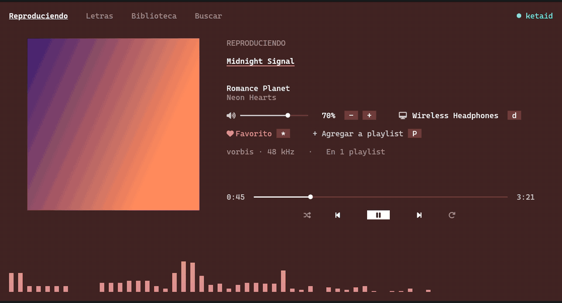
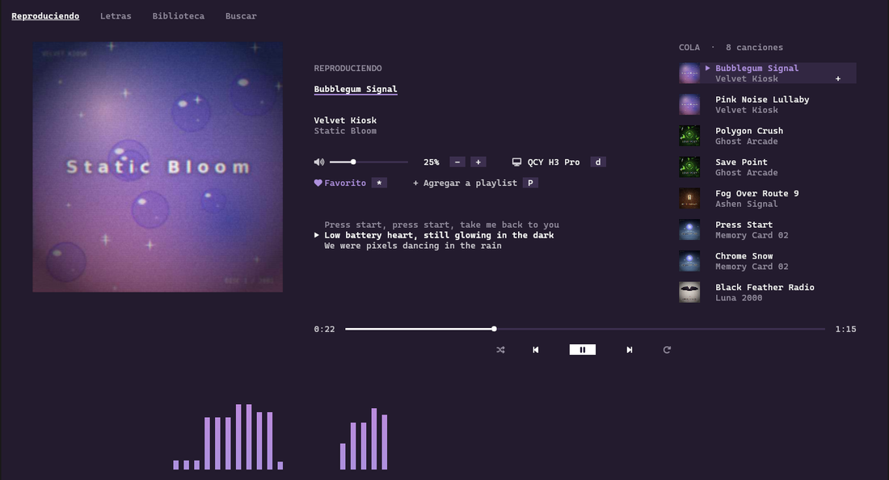
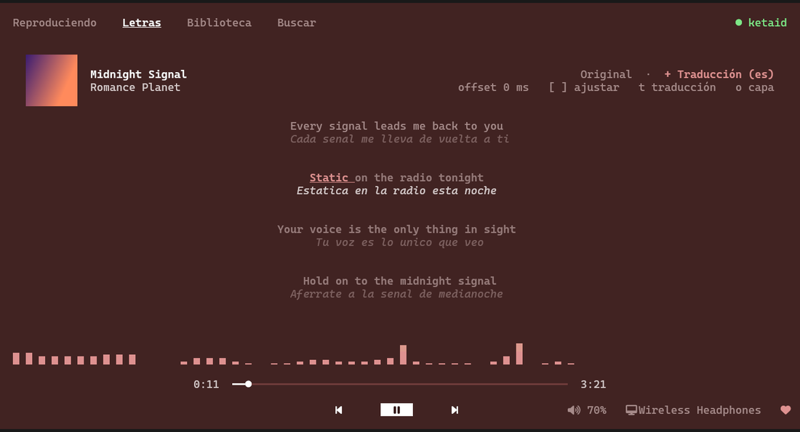
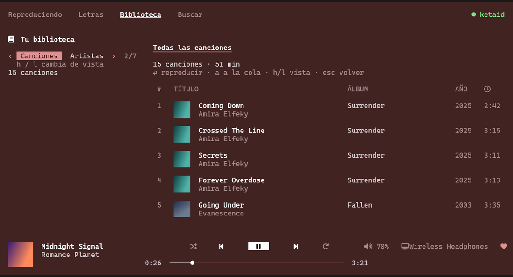
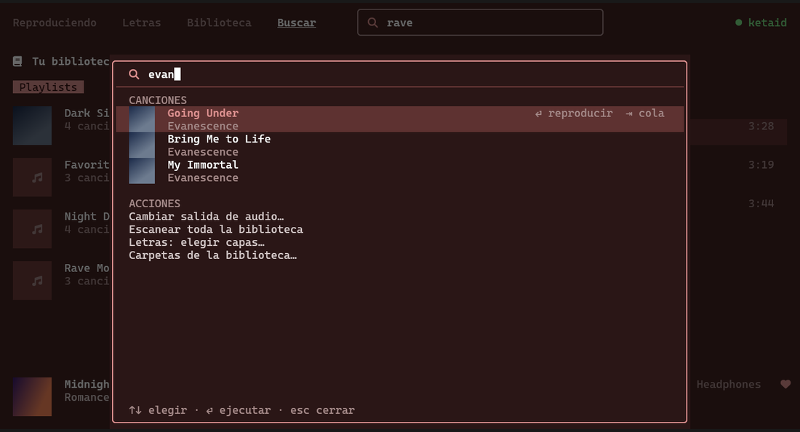
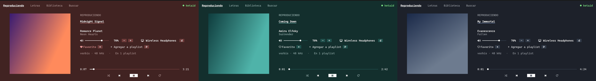

<div align="center">

# ketai

**Reproductor de musica para la terminal, con daemon propio, letras sincronizadas y colores que cambian con cada caratula.**




<sub>Video en mejor calidad: <a href="docs/assets/demo.mp4">docs/assets/demo.mp4</a>. Las canciones, caratulas y letras del video son de demostracion (audio generado).</sub>

</div>

---

## Que es ketai

ketai son dos programas que trabajan juntos:

- **`ketaid`**, el servicio de audio. Reproduce, lleva la cola, la biblioteca, las playlists y las letras. Corre en segundo plano (como servicio de systemd) y sigue sonando aunque cierres la terminal.
- **`ketai`**, el cliente de terminal (TUI). Muestra y controla lo que hace el daemon. Podes abrir varios a la vez (por ejemplo uno grande y otro chico en un panel) y todos ven lo mismo.

Hablan por un protocolo simple (JSON por un socket local), asi que tambien se puede controlar ketai desde scripts, desde waybar o con `playerctl` (MPRIS). La explicacion completa esta en [docs/guia/arquitectura.md](docs/guia/arquitectura.md).

## Funciones

<table>
<tr>
<td width="50%"></td>
<td width="50%"></td>
</tr>
<tr>
<td><b>Reproduciendo</b><br>Caratula grande, progreso, controles, volumen, salida de audio, favorito y espectro en vivo.</td>
<td><b>Letras sincronizadas</b><br>Linea por linea o palabra por palabra (karaoke), con traduccion debajo y ajuste de tiempo.</td>
</tr>
<tr>
<td></td>
<td></td>
</tr>
<tr>
<td><b>Biblioteca</b><br>Playlists, todas las canciones, o agrupadas por artista, album, carpeta, ano o genero, en columnas.</td>
<td><b>Busqueda</b><br>Por titulo, artista, album, genero o ano, en cualquier parte del texto y sin importar acentos ni mayusculas.</td>
</tr>
<tr>
<td></td>
<td></td>
</tr>
<tr>
<td><b>Acciones rapidas (<code>Ctrl+P</code>)</b><br>Buscar y reproducir sin cambiar de pantalla, o ejecutar acciones.</td>
<td><b>Playlists y favoritos</b><br>Agregar, quitar y crear playlists desde donde estes; ketai avisa si la cancion ya estaba.</td>
</tr>
</table>

<div align="center">

<br><sub><b>Tema dinamico:</b> toda la interfaz toma los colores de la caratula que suena, y la siguiente se prepara por adelantado para que el cambio sea instantaneo.</sub>
</div>

Y ademas:

- **Formatos**: FLAC, MP3, AAC y HE-AAC (M4A), ALAC, Ogg Vorbis, Opus y WAV.
- **Biblioteca en SQLite**: escaneo por tandas, metadatos (genero, ano, numero de pista, artista del album) y busqueda en menos de un milisegundo con miles de canciones.
- **Playlists `.m3u8`**: viven en la base de ketai y se copian como archivos `.m3u8` para usarlas con otros reproductores.
- **Salida de audio**: elegir dispositivo (PulseAudio o PipeWire), y la salida se abre solo mientras suena.
- **Mouse**: clic en todo, doble clic para reproducir, arrastrar las barras de progreso y volumen, rueda en las listas.
- **Atajos configurables** y **temas** en un archivo de configuracion que se recarga en vivo al guardar.
- **Modo mini** para paneles chicos (herdr, tmux) y **MPRIS** para teclas multimedia, `playerctl` y waybar.

Todas las funciones, con su explicacion, estan en [docs/guia/funciones.md](docs/guia/funciones.md).

## Plataforma

ketai funciona **solo en Linux**. Usa piezas propias de Linux: `/proc`, servicios de usuario de systemd, PulseAudio o PipeWire para la salida de audio, y D-Bus para MPRIS. Otras plataformas no estan soportadas por ahora.

La TUI necesita una terminal con el **protocolo de graficos de kitty** para mostrar caratulas: kitty, Ghostty, WezTerm, Konsole, o un multiplexor que lo soporte (por ejemplo herdr). Sin eso arranca igual con `KETAI_NO_IMAGES=1`, sin caratulas. Tambien hace falta una **Nerd Font** para los iconos.

## Instalacion

Por ahora se instala desde el codigo fuente. Instalarlo con un gestor de paquetes esta planificado (ver [docs/roadmap.md](docs/roadmap.md)).

Requisitos para compilar: Rust (edicion 2024), `cmake` y un compilador de C (para `libopus` y `fdk-aac`), y las bibliotecas de desarrollo de PulseAudio y D-Bus.

```sh
git clone https://github.com/4t-ritch/ketai.git
cd ketai
cargo build --release

# Binarios en tu PATH
install -Dm755 target/release/ketaid target/release/ketai -t ~/.local/bin/

# El daemon como servicio de usuario (arranca solo cuando un cliente lo necesita)
install -Dm644 dist/systemd/ketaid.{socket,service} -t ~/.config/systemd/user/
systemctl --user daemon-reload
systemctl --user enable --now ketaid.socket
```

Mas detalles del servicio en [docs/servicio.md](docs/servicio.md).

## Primeros pasos

1. Abri la TUI: `ketai`.
2. Agrega tu carpeta de musica: `f` abre Carpetas, `a` agrega una (`~/music`, por ejemplo) y `S` escanea todo.
3. Busca algo con `4` (Buscar) o con `Ctrl+P` desde cualquier pantalla, y `Enter` para reproducir.
4. `1` a `4` cambian de pestana: Reproduciendo, Letras, Biblioteca y Buscar.

La guia paso a paso esta en [docs/guia/primeros-pasos.md](docs/guia/primeros-pasos.md).

### Atajos principales

| Tecla | Accion | Tecla | Accion |
|---|---|---|---|
| `espacio` | reproducir o pausar | `Ctrl+P` | acciones y busqueda rapida |
| `n` / `p` | siguiente / anterior | `*` | marcar como favorita |
| flechas izquierda / derecha | retroceder / adelantar 5 s | `P` | agregar a una playlist |
| `+` / `-` | volumen | `d` | salida de audio |
| `s` / `r` | aleatorio / repeticion | `f` | carpetas de la biblioteca |
| `1` a `4` | pestanas | `q` | salir |

Todos los atajos globales se pueden cambiar. La lista completa esta en [docs/tui.md](docs/tui.md).

## Configuracion

Un solo archivo: `~/.config/ketai/config.toml`. Se aplica al guardar, sin reiniciar.

```toml
[theme]
cover_color = true          # toda la interfaz con los colores de la caratula

[keys]
actions = ["ctrl+p", "f1"]  # cambia o suma atajos
toggle = "space"

[playlists]
dir = "~/music/playlists"   # donde se copian las playlists (.m3u8)
```

| Que | Donde aprenderlo |
|---|---|
| Ejemplo completo para empezar | [examples/config.toml](examples/config.toml) |
| Temas: `cover_color`, cada color y ejemplos | [examples/theme/](examples/theme/README.md) |
| Atajos: formato, acciones y ejemplos | [examples/keys/](examples/keys/README.md) |
| Referencia de todas las claves | [docs/config.md](docs/config.md) |

## Documentacion

| Documento | Contenido |
|---|---|
| [docs/guia/](docs/guia/README.md) | Guia de uso: primeros pasos, todas las funciones y como esta armado ketai |
| [docs/tui.md](docs/tui.md) | Referencia de la TUI: pantallas, teclas, mouse |
| [docs/config.md](docs/config.md) | Referencia de `config.toml` |
| [docs/servicio.md](docs/servicio.md) | El daemon como servicio de systemd |
| [docs/protocol.md](docs/protocol.md) | Protocolo para controlar ketai desde otros programas |
| [docs/mpris.md](docs/mpris.md) | Integracion MPRIS (playerctl, waybar, teclas multimedia) |
| [docs/formatos.md](docs/formatos.md) | Formatos de audio soportados |
| [docs/roadmap.md](docs/roadmap.md) | Lo planificado para las proximas versiones |

## Proximamente

Para la proxima major update estan planificados: fuentes remotas con descarga a cache, instalacion con gestores de paquetes, varios temas, la interfaz en varios idiomas, romanizacion automatica de letras y estimacion de tiempos por palabra. Detalles en [docs/roadmap.md](docs/roadmap.md).

## Participar

ketai es un proyecto personal y abierto para usar. **Los reportes y propuestas van por [issues](https://github.com/4t-ritch/ketai/issues)**: errores, ideas o preguntas. El repositorio no acepta pull requests; si queres proponer un cambio, abri un issue y lo vemos ahi. Mas detalles en [CONTRIBUTING.md](CONTRIBUTING.md).

## Licencia

MIT. Ver [LICENSE](LICENSE).
