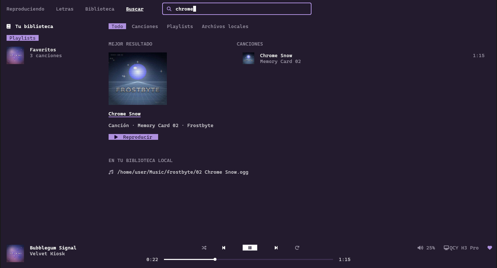
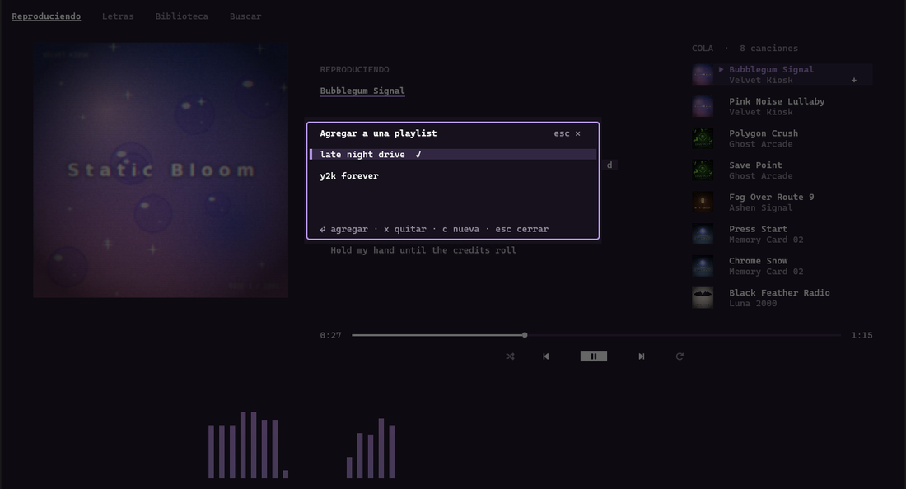
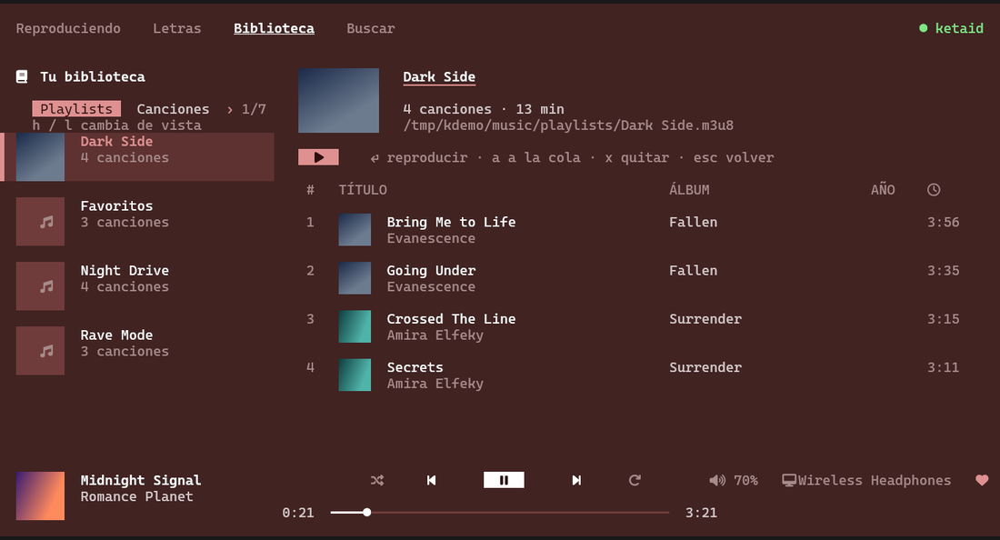
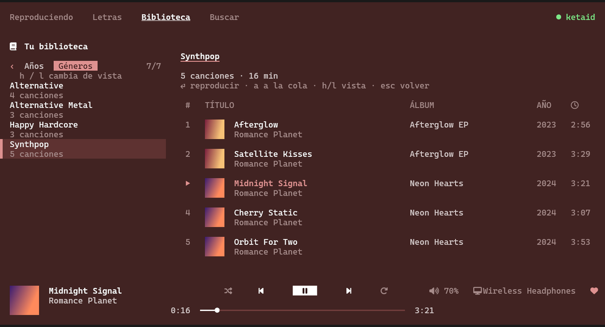

<div align="center">

# ketai

**A music player for the terminal, with its own daemon, synced lyrics and colors that change with every cover.**

**English** | [Espanol](README.es.md)

[](https://crates.io/crates/ketai)
[](https://crates.io/crates/ketai)
[](LICENSE)


<br>


[](https://github.com/4t-ritch/ketai/commits/main)

</div>

https://github.com/user-attachments/assets/83eae727-f8c6-4894-bb95-a84329965fac

<div align="center">
<sub>The songs, covers and lyrics in the video are for demonstration (generated audio). Also in the repo: <a href="docs/assets/demo.mp4">docs/assets/demo.mp4</a>.</sub>

</div>

> **Documentation in Spanish:** every document has a Spanish version. Look for the
> *Espanol* link at the top of each page, or start at [README.es.md](README.es.md).

---

## What is ketai

ketai is two programs that work together:

- **`ketaid`**, the audio service. It plays, and keeps the queue, the library, the playlists and the lyrics. It runs in the background (as a systemd service) and keeps playing even if you close the terminal.
- **`ketai`**, the terminal client (TUI). It shows and controls what the daemon does. You can open several at once (for example a big one and a small one in a pane) and they all see the same.

They talk through a simple protocol (JSON over a local socket), so ketai can also be controlled from scripts, from waybar or with `playerctl` (MPRIS). The full explanation is in [docs/guide/architecture.md](docs/guide/architecture.md) ([Spanish](docs/es/guide/architecture.md)).

## Features

<table>
<tr>
<td width="50%"></td>
<td width="50%"></td>
</tr>
<tr>
<td><b>Now Playing</b><br>Large cover, progress, controls, volume, audio output, favorite, live spectrum and the whole queue (reorder, remove, add to a playlist).</td>
<td><b>Synced lyrics</b><br>Line by line or word by word (karaoke), with a translation below and timing adjustment.</td>
</tr>
<tr>
<td></td>
<td></td>
</tr>
<tr>
<td><b>Library</b><br>Playlists, all songs, or grouped by artist, album, folder, year or genre, in columns.</td>
<td><b>Search</b><br>By title, artist, album, genre or year, anywhere in the text, ignoring accents and case.</td>
</tr>
<tr>
<td></td>
<td></td>
</tr>
<tr>
<td><b>Quick actions (<code>Ctrl+P</code>)</b><br>Search and play without leaving the screen, or run actions.</td>
<td><b>Playlists and favorites</b><br>Add, remove and create playlists from anywhere; ketai warns you if the song was already there.</td>
</tr>
<tr>
<td></td>
<td></td>
</tr>
<tr>
<td><b>Playlists</b><br>Each playlist with its cover, length and songs; play it, queue it or edit it, with a preview of what is playing.</td>
<td><b>Browse by group</b><br>Artists, albums, folders, years and genres: choose one on the left and its songs open on the right.</td>
</tr>
</table>

<div align="center">

<br><sub><b>Dynamic theme:</b> the whole interface takes the colors of the playing cover, and the next one is prepared ahead of time so the change is instant.</sub>
</div>

And also:

- **Formats**: FLAC, MP3, AAC and HE-AAC (M4A), ALAC, Ogg Vorbis, Opus and WAV.
- **SQLite library**: scanning in batches, metadata (genre, year, track number, album artist) and search in under a millisecond with thousands of songs.
- **`.m3u8` playlists**: they live in ketai's database and are copied as `.m3u8` files to use them with other players.
- **Audio output**: choose the device (PulseAudio or PipeWire); the output is only open while playing.
- **Mouse**: click everything, double click to play, drag the progress and volume bars, wheel on lists.
- **Configurable shortcuts** and **themes** in a configuration file that reloads live when saved.
- **Mini mode** for small panes (herdr, tmux) and **MPRIS** for media keys, `playerctl` and waybar.
- **One command to install**: `cargo install ketai` brings the daemon and the TUI; the first time you open it, it sets up the daemon as a service.
- **Light**: the daemon only starts when a client connects (systemd socket activation), and covers are not kept in memory once shown.

The interface is in Spanish for now; more languages are planned (see the roadmap).

Every feature, explained: [docs/guide/features.md](docs/guide/features.md) ([Spanish](docs/es/guide/features.md)).

## Platform

ketai works **on Linux only**. It uses Linux-specific pieces: `/proc`, systemd user services, PulseAudio or PipeWire for the audio output, and D-Bus for MPRIS. Other platforms are not supported for now.

The TUI needs a terminal with the **kitty graphics protocol** to show covers: kitty, Ghostty, WezTerm, Konsole, or a multiplexer that supports it (for example herdr). Without it, it still starts with `KETAI_NO_IMAGES=1`, without covers. A **Nerd Font** is also needed for the icons.

## Installation

Build requirements (both ways compile on your machine): Rust (2024 edition),
`cmake` and a C compiler (for `libopus` and `fdk-aac`), and the PulseAudio
and D-Bus development libraries.

### With cargo

```sh
cargo install ketai
```

It installs both binaries, `ketai` (the TUI) and `ketaid` (the daemon), in
`~/.cargo/bin`. The first time you open `ketai`, it offers to install the
daemon as a user service: press Enter and from then on the daemon starts by
itself whenever a client needs it.

Optional: for smaller binaries (the same optimizations as a build from
source), install it with:

```sh
CARGO_PROFILE_RELEASE_LTO=true CARGO_PROFILE_RELEASE_STRIP=true \
CARGO_PROFILE_RELEASE_CODEGEN_UNITS=1 cargo install ketai
```

### From source

```sh
git clone https://github.com/4t-ritch/ketai.git
cd ketai
cargo build --release

# Binaries in your PATH
install -Dm755 target/release/ketaid target/release/ketai -t ~/.local/bin/

# The daemon as a user service (it starts only when a client needs it)
install -Dm644 crates/ketai-tui/systemd/ketaid.{socket,service} -t ~/.config/systemd/user/
systemctl --user daemon-reload
systemctl --user enable --now ketaid.socket
```

To install from a clone with cargo instead: `cargo install --path crates/ketai`.

Installing with system package managers is planned (see
[docs/roadmap.md](docs/roadmap.md), [Spanish](docs/es/roadmap.md)).

More about the service in [docs/service.md](docs/service.md) ([Spanish](docs/es/service.md)).

## Getting started

1. Open the TUI: `ketai`.
2. Add your music folder: `f` opens Folders, `a` adds one (`~/music`, for example) and `S` scans everything.
3. Search with `4` (Search) or with `Ctrl+P` from any screen, and `Enter` to play.
4. `1` to `4` change tabs: Now Playing, Lyrics, Library and Search.

The step-by-step guide is in [docs/guide/getting-started.md](docs/guide/getting-started.md) ([Spanish](docs/es/guide/getting-started.md)).

### Main shortcuts

| Key | Action | Key | Action |
|---|---|---|---|
| `space` | play or pause | `Ctrl+P` | actions and quick search |
| `n` / `p` | next / previous | `*` | mark as favorite |
| left / right arrows | back / forward 5 s | `P` | add to a playlist |
| `+` / `-` | volume | `d` | audio output |
| `s` / `r` | shuffle / repeat | `f` | library folders |
| `1` to `4` | tabs | `q` | quit |

Every global shortcut can be changed. The full list is in [docs/tui.md](docs/tui.md) ([Spanish](docs/es/tui.md)).

## Configuration

A single file: `~/.config/ketai/config.toml`. It applies when saved, without restarting.

```toml
[theme]
cover_color = true          # the whole interface with the cover's colors

[keys]
actions = ["ctrl+p", "f1"]  # change or add shortcuts
toggle = "space"

[playlists]
dir = "~/music/playlists"   # where playlists are copied (.m3u8)
```

| What | Where to learn it | Spanish |
|---|---|---|
| Complete example to start with | [examples/config.toml](examples/config.toml) | - |
| Themes: `cover_color`, each color and examples | [examples/theme/](examples/theme/README.md) | [Espanol](examples/theme/README.es.md) |
| Shortcuts: format, actions and examples | [examples/keys/](examples/keys/README.md) | [Espanol](examples/keys/README.es.md) |
| Reference of every key | [docs/config.md](docs/config.md) | [Espanol](docs/es/config.md) |

## Documentation

Every document is available in English and in Spanish.

| Document | Contents | Spanish |
|---|---|---|
| [docs/guide/](docs/guide/README.md) | User guide: getting started, every feature and how ketai is built | [Espanol](docs/es/guide/README.md) |
| [docs/tui.md](docs/tui.md) | TUI reference: screens, keys, mouse | [Espanol](docs/es/tui.md) |
| [docs/config.md](docs/config.md) | `config.toml` reference | [Espanol](docs/es/config.md) |
| [docs/service.md](docs/service.md) | The daemon as a systemd service | [Espanol](docs/es/service.md) |
| [docs/protocol.md](docs/protocol.md) | Protocol to control ketai from other programs, with a quick start | [Espanol](docs/es/protocol.md) |
| [docs/mpris.md](docs/mpris.md) | MPRIS integration (playerctl, waybar, media keys) | [Espanol](docs/es/mpris.md) |
| [docs/formats.md](docs/formats.md) | Supported audio formats | [Espanol](docs/es/formats.md) |
| [docs/roadmap.md](docs/roadmap.md) | What is planned for the next versions | [Espanol](docs/es/roadmap.md) |

## Coming next

Planned for the next major update: remote sources with download to cache, installation with package managers, multiple themes, the interface in several languages, a graphical karaoke client with background video and shaders, automatic lyrics romanization and word timing estimation. Details in [docs/roadmap.md](docs/roadmap.md) ([Spanish](docs/es/roadmap.md)).

## Contributing

ketai is a personal project, open for anyone to use. **Reports and proposals go through [issues](https://github.com/4t-ritch/ketai/issues)**: bugs, ideas or questions, in English or Spanish. The repository does not accept pull requests; if you want to propose a change, open an issue and we will talk it over there. More in [CONTRIBUTING.md](CONTRIBUTING.md) ([Spanish](CONTRIBUTING.es.md)).

## License

MIT. See [LICENSE](LICENSE).
