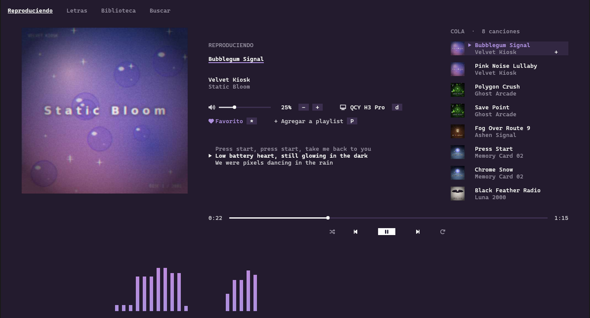
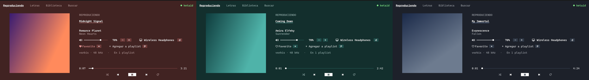
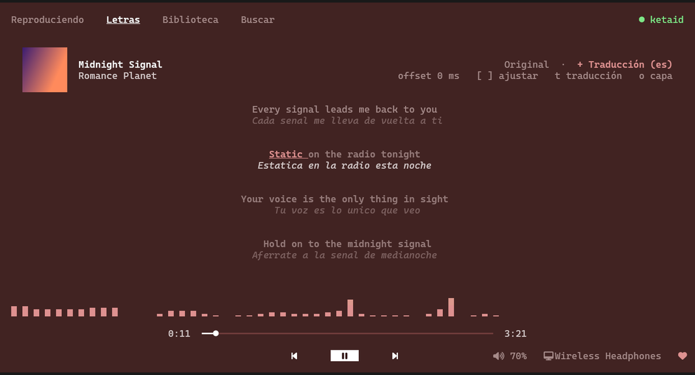
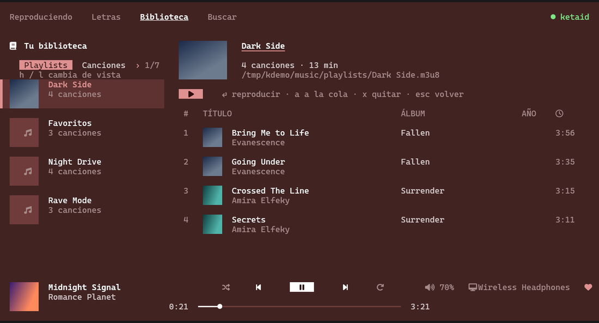
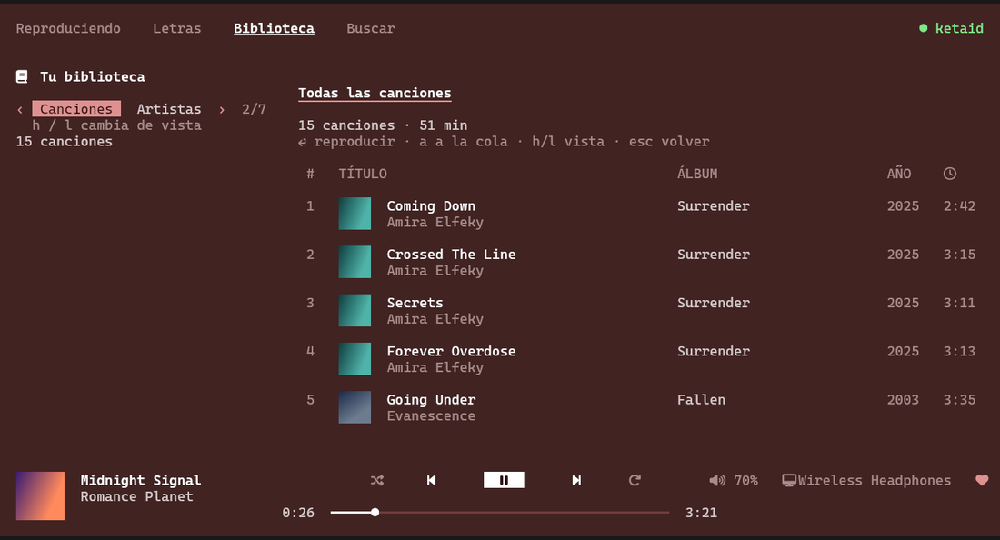
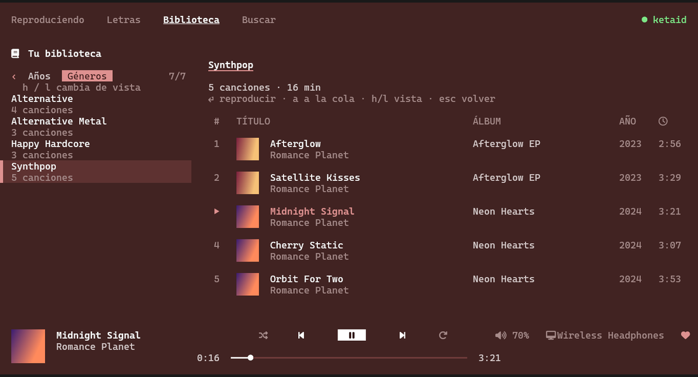
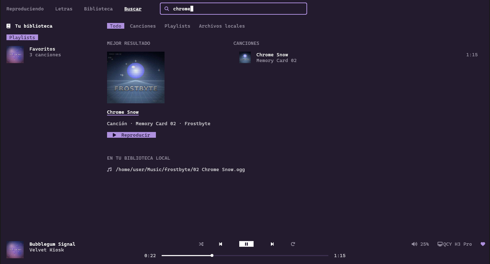
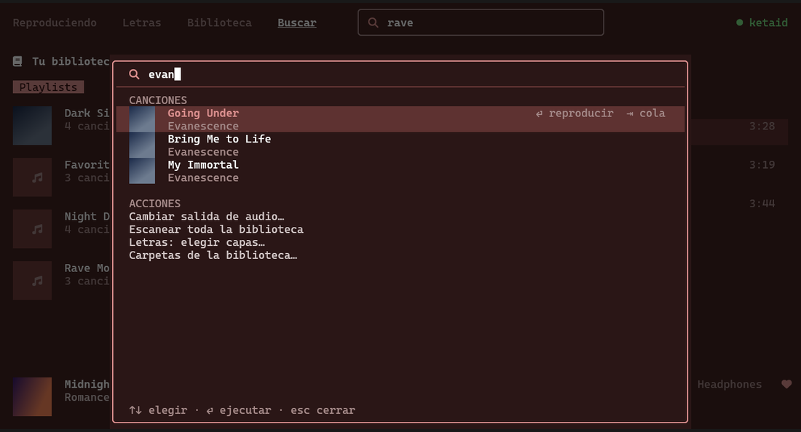
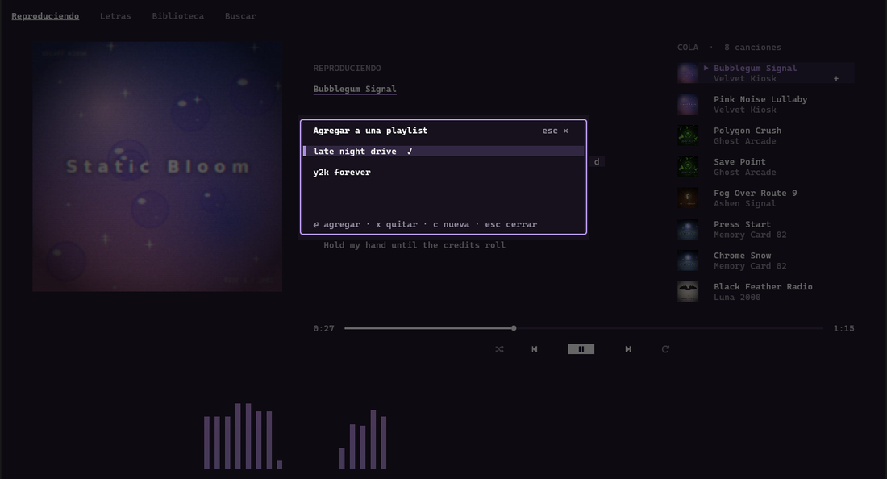
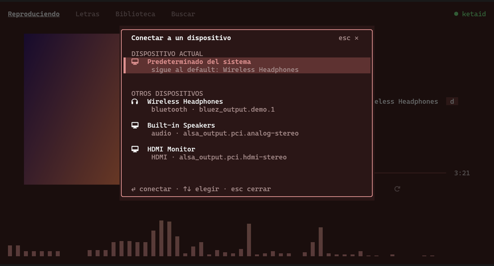

[English](../../guide/features.md) | **Espanol**

# Funciones de ketai

Pantalla por pantalla, todo lo que hace ketai. Las teclas son las de por
defecto; los atajos globales se pueden cambiar (ver
[examples/keys/](../../../examples/keys/README.es.md)). Todo lo que se ve tambien
responde al mouse.

## Reproduciendo (`1`)

- Caratula grande, titulo, artista y album.
- Volumen con sus teclas (`-` / `+`) y la salida de audio activa (`d` para
  cambiarla).
- **Favorito** (`*`) y **Agregar a playlist** (`P`).
- En cuantas playlists esta la cancion.
- **Cola** a la derecha: la cola completa en su orden real, con la caratula,
  el titulo (se desplaza si no entra) y el artista de cada cancion. La que
  suena va marcada y las que ya sonaron, mas tenues; avisa si la cola se
  repite al terminar o va en orden aleatorio. Se elige una cancion con las
  flechas o un clic, se reproduce con `Enter` o doble clic, se mueve con
  `K` / `J` o arrastrandola, se quita con `x` y se agrega a una playlist con
  `a` (sin reproducirla). Solo se ve si la pantalla es lo bastante ancha.
- Barra de progreso (clic o arrastrar para moverse), controles y espectro en
  vivo.
- Si el titulo no entra, se desplaza para leerlo completo.

## Tema dinamico

Con `cover_color = true` toda la interfaz toma los colores de la caratula que
suena: fondo, paneles, acento, textos secundarios y espectro. La caratula de
la siguiente cancion se prepara por adelantado, asi el cambio de color es
instantaneo. Tambien se pueden usar colores fijos (ver
[examples/theme/](../../../examples/theme/README.es.md)).

## Letras (`2`)

- Letras sincronizadas **por linea** o **por palabra** (karaoke): la palabra
  que suena se resalta.
- **Traducciones** debajo de cada linea (`t` la muestra u oculta) y capas
  extra, como la version romanizada (`o` cambia la capa principal).
- **Ajuste de tiempo** (`[` / `]`, de a 50 ms), que se guarda por archivo.
- Si la letra no trae tiempos por palabra, `w` los estima.
- La linea que se canta queda en el centro; un clic en una linea (con su
  traduccion) salta a ese tramo de la cancion. Cuantas lineas se ven arriba
  y abajo se configura en `[lyrics]`.
- **Modo karaoke** (`k`): la linea que se canta se va pintando de a poco, por
  dentro de las letras, como los karaokes de video, con el tamano de
  `[lyrics] size` (ver [../config.md](../config.md#lyrics)).
- Las letras se leen de archivos junto al audio (`cancion.lrc`,
  `cancion.ttml`, `cancion.txt`; traduccion en `cancion.es.lrc`) o de las
  letras que traiga el propio archivo de audio.

## Biblioteca (`3`)

| Playlists | Todas las canciones | Por grupos |
|---|---|---|
|  |  |  |

- `h` / `l` cambian de vista: **Playlists**, **Canciones** (toda la
  biblioteca), **Artistas**, **Albumes**, **Carpetas**, **Anos** y
  **Generos**.
- La lista va en columnas: numero, titulo y artista, album, ano y duracion.
- `Enter` reproduce desde la cancion elegida (pone toda la lista en la
  cola); `a` agrega una sola a la cola.
- En una playlist, `x` quita la cancion elegida. En Playlists, `c` crea una
  nueva.
- Las canciones sin el dato de un grupo (por ejemplo sin genero) quedan en
  "Sin dato".

## Buscar (`4`)

- Busca en titulo, artista, album, artista del album, genero, ano y nombre
  de archivo.
- Encuentra el texto **en cualquier parte** (no solo al principio) y **no
  importan acentos ni mayusculas**: "cancion" encuentra "Cancion" con
  acento, "nino" encuentra "Nino" con enie.
- Mejor resultado, canciones, playlists y archivos locales, con filtros
  (`h` / `l`).

## Acciones rapidas (`Ctrl+P`)

Desde cualquier pantalla: escribi para buscar canciones y playlists, o
elegi una accion (salida de audio, escanear la biblioteca, capas de letras,
carpetas). `Enter` reproduce o ejecuta, `Tab` agrega a la cola.

## Playlists y favoritos

- `P` abre la lista de playlists: `Enter` agrega la cancion que suena, `x`
  la quita (las que ya la tienen llevan una marca) y `c` crea una nueva.
- Si la cancion ya estaba, ketai pregunta antes de repetirla.
- `*` la marca como favorita: queda en la playlist **Favoritos**.
- Una cancion puede estar en varias playlists. Las playlists viven en la base
  de ketai y se copian como archivos `.m3u8` (por defecto en
  `~/music/playlists`), para usarlas con otros reproductores. Un `.m3u8`
  nuevo que copies a esa carpeta se importa solo.

## Salida de audio (`d`)

Lista las salidas (auriculares, parlantes, HDMI) y cambia a la elegida sin
cortar la reproduccion. "Predeterminado del sistema" sigue al dispositivo
por defecto aunque cambie. La salida se abre solo mientras suena, asi ketai
no interfiere con el audio de otros programas.

## Carpetas de la biblioteca (`f`)

Las carpetas que ketai indexa, con cuantas canciones tiene cada una. `a`
agrega, `x` quita, `s` escanea la elegida y `S` todas. El escaneo guarda por
tandas: si se corta a mitad, lo leido queda.

## Modo mini

Si la terminal es chica (menos de 72 columnas o 15 filas), ketai pasa solo a
una vista compacta: caratula, cancion, una linea de letra, progreso y
controles. Ideal para un panel de herdr o tmux.

## Mouse

Clic en pestanas, controles, botones, listas y popups; doble clic reproduce;
las barras de progreso y volumen se arrastran; la rueda mueve la lista bajo
el puntero; clic fuera de un popup lo cierra.

## Fuera de la TUI

- **MPRIS**: teclas multimedia, `playerctl` y los modulos de waybar
  controlan ketai (ver [../mpris.md](../mpris.md)).
- **Protocolo**: cualquier programa puede controlar ketai por su socket
  (ver [../protocol.md](../protocol.md), que arranca con un ejemplo rapido).
- **Varias TUIs a la vez**: todas ven y controlan el mismo reproductor.
