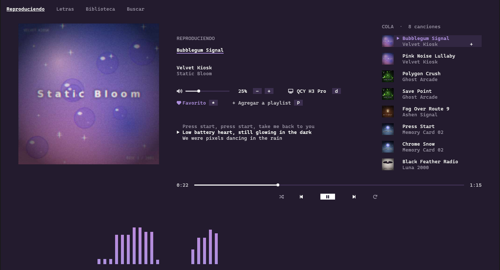
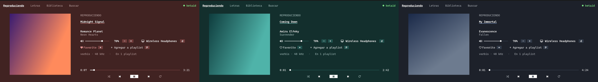
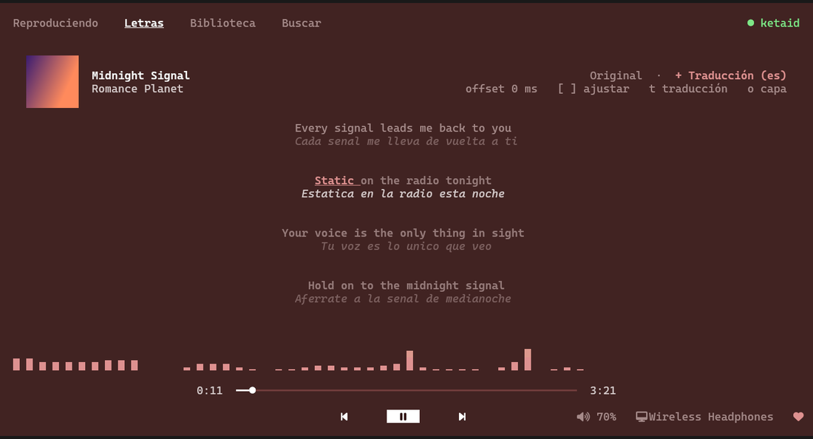
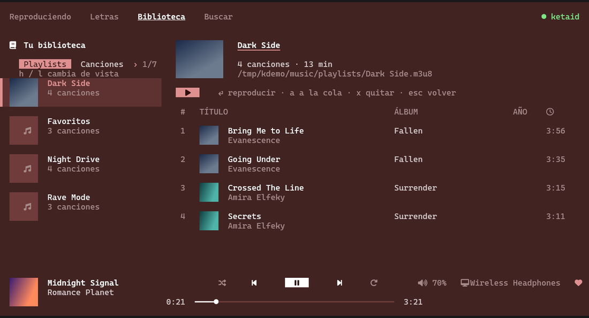
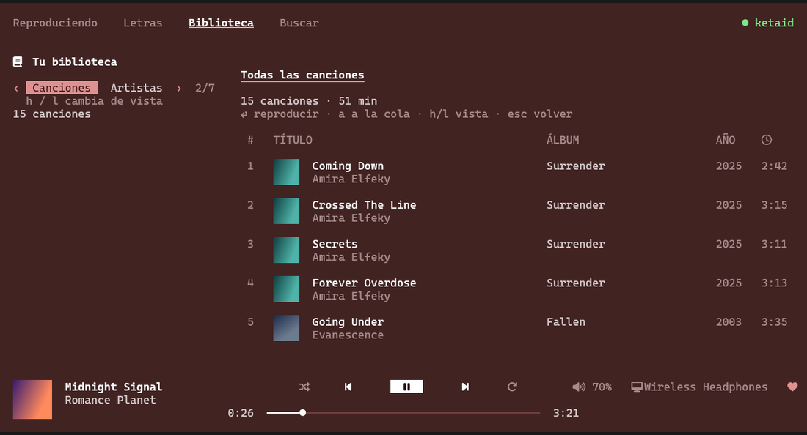
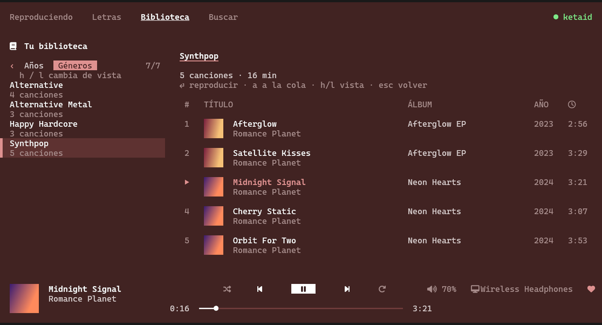
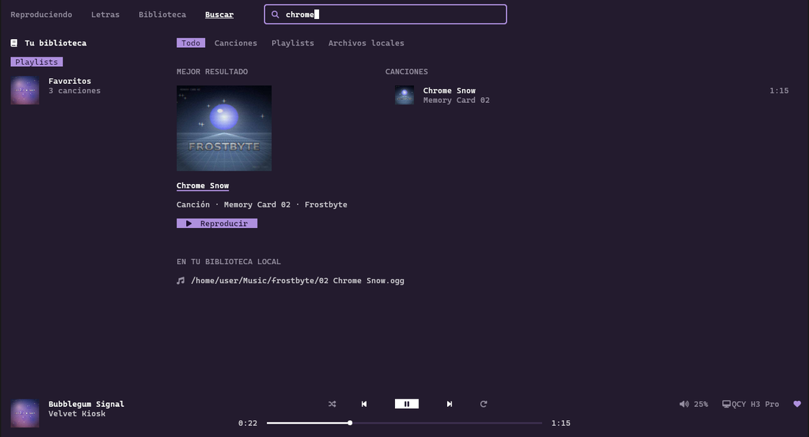
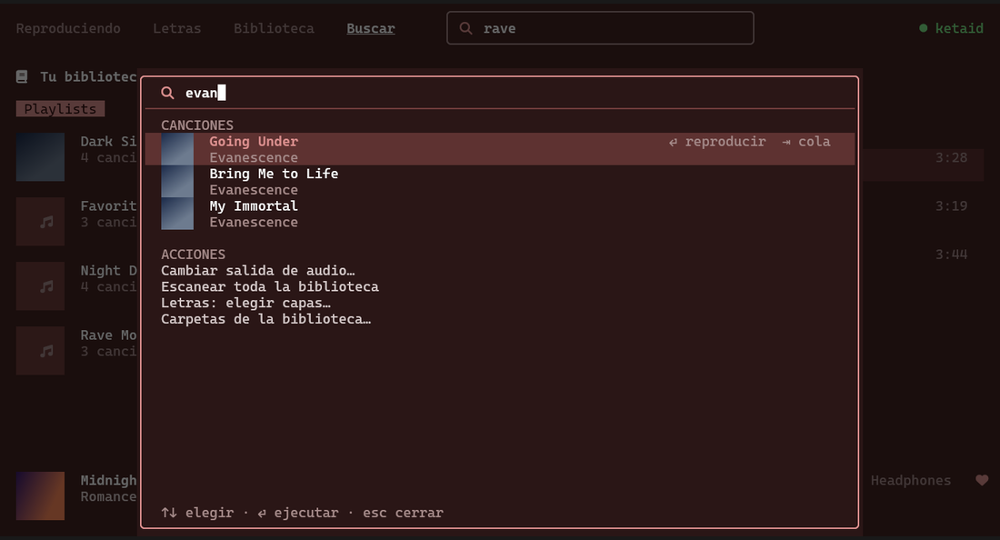
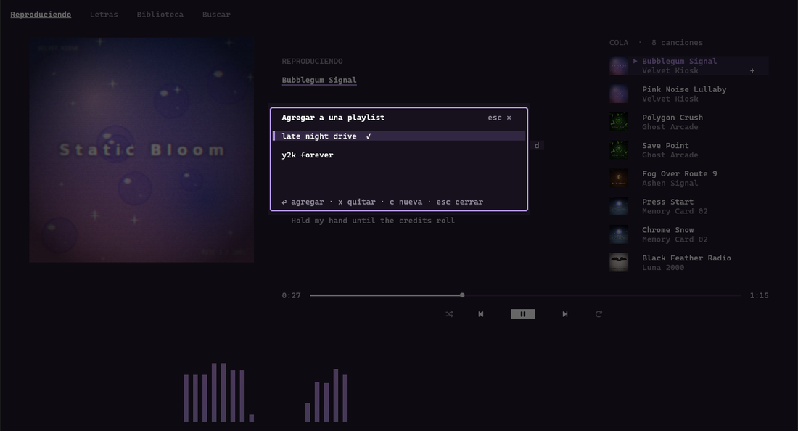
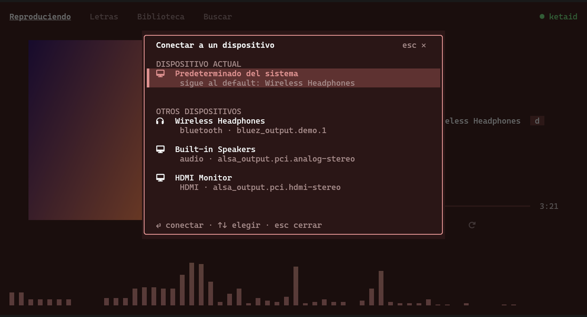

**English** | [Espanol](../es/guide/features.md)

# ketai features

Screen by screen, everything ketai does. The keys are the defaults; the
global shortcuts can be changed (see
[examples/keys/](../../examples/keys/README.md)). Everything on screen also
responds to the mouse.

The interface is in Spanish for now; each screen is named here in English
with its on-screen label in italics.

## Now Playing (*Reproduciendo*, `1`)

- Large cover, title, artist and album.
- Volume with its keys (`-` / `+`) and the active audio output (`d` to
  change it).
- **Favorite** (`*`) and **Add to playlist** (`P`).
- In how many playlists the song is.
- **Queue** on the right: the whole queue in its real order, with each
  song's cover, title and artist (the title of the one playing scrolls if it
  does not fit; the others are cut, so long lists stay calm). The one
  playing is marked and the ones already played are dimmer; it says when the
  queue repeats at the end or plays in random order. Choose a song with the
  arrows or a click, play it with `Enter` or a double click, move it with
  `K` / `J` or by dragging it, remove it with `x` and add it to a playlist
  with `a` (without playing it). It only shows when the screen is wide
  enough.
- Progress bar (click or drag to move), controls and live spectrum.
- If the title does not fit, it scrolls so it can be read in full.

## Dynamic theme

With `cover_color = true` the whole interface takes the colors of the playing
cover: background, panels, accent, secondary text and spectrum. The next
song's cover is prepared ahead of time, so the color change is instant. Fixed
colors can be used too (see [examples/theme/](../../examples/theme/README.md)).

## Lyrics (*Letras*, `2`)

- Lyrics synced **per line** or **per word** (karaoke): the word being sung
  is highlighted.
- **Translations** under each line (`t` shows or hides them) and extra layers,
  such as the romanized version (`o` changes the primary layer).
- **Timing adjustment** (`[` / `]`, in 50 ms steps), stored per file.
- If the lyrics have no word timing, `w` estimates it.
- The line being sung stays in the middle; clicking a line (with its
  translation) jumps to that part of the song. How many lines are shown
  above and below is set in `[lyrics]`.
- **Karaoke mode** (`k`): the line being sung fills in gradually, inside the
  letters, like video karaoke, at the size set with `[lyrics] size` (see
  [../config.md](../config.md#lyrics)).
- Lyrics are read from files next to the audio (`song.lrc`, `song.ttml`,
  `song.txt`; translation in `song.es.lrc`) or from the lyrics embedded in
  the audio file itself.

## Library (*Biblioteca*, `3`)

| Playlists | All songs | By groups |
|---|---|---|
|  |  |  |

- `h` / `l` change the view: **Playlists**, **Songs** (the whole library),
  **Artists**, **Albums**, **Folders**, **Years** and **Genres**.
- The list is in columns: number, title and artist, album, year and
  duration.
- `Enter` plays from the selected song (it puts the whole list in the queue);
  `a` adds just one to the queue.
- In a playlist, `x` removes the selected song. In Playlists, `c` creates a
  new one.
- Songs without a group's data (for example without a genre) go under "No
  data" (*Sin dato*).

## Search (*Buscar*, `4`)

- Searches title, artist, album, album artist, genre, year and file name.
- Finds the text **anywhere** (not only at the start) and **accents and case
  do not matter**: "cancion" finds "Cancion" with an accent, "nino" finds
  "Nino" with an n with tilde.
- Top result, songs, playlists and local files, with filters (`h` / `l`).

## Quick actions (`Ctrl+P`)

From any screen: type to search songs and playlists, or pick an action
(audio output, scan the library, lyrics layers, folders, see the keyboard
shortcuts, look for lyrics again). `Enter` plays or runs, `Tab` adds to the
queue. *Ver atajos de teclado* lists every action with the keys configured
right now.

A lyrics file you drop next to the song that is playing shows up by itself
within a couple of seconds, no restart needed. *Letras: volver a buscar*
("look for lyrics again") forces it right away.

## Playlists and favorites

- `P` opens the list of playlists: `Enter` adds the playing song, `x`
  removes it (playlists that already have it carry a mark) and `c` creates a
  new one.
- If the song was already there, ketai asks before repeating it.
- `*` marks it as a favorite: it goes into the **Favoritos** playlist.
- A song can be in several playlists. Playlists live in ketai's database and
  are copied as `.m3u8` files (by default in `~/music/playlists`), to use
  them with other players. A new `.m3u8` you copy into that folder is
  imported by itself.

## Audio output (`d`)

Lists the outputs (headphones, speakers, HDMI) and switches to the chosen one
without stopping playback. "System default" (*Predeterminado del sistema*)
follows the default device even if it changes. The output is only open while
playing, so ketai does not interfere with other programs' audio.

## Library folders (`f`)

The folders ketai indexes, with how many songs each has. `a` adds, `x`
removes, `s` scans the selected one and `S` all of them. Scanning saves in
batches: if it stops halfway, what was read stays.

## Mini mode

If the terminal is small (fewer than 72 columns or 15 rows), ketai switches
by itself to a compact view: cover, song, one lyrics line, progress and
controls. Ideal for a herdr or tmux pane.

## Mouse

Click tabs, controls, buttons, lists and popups; a double click plays; the
progress and volume bars can be dragged; the wheel scrolls the list under the
pointer; clicking outside a popup closes it.

## Outside the TUI

- **MPRIS**: media keys, `playerctl` and waybar modules control ketai (see
  [../mpris.md](../mpris.md)).
- **Protocol**: any program can control ketai through its socket (see
  [../protocol.md](../protocol.md), which starts with a quick example).
- **Several TUIs at once**: they all see and control the same player.
